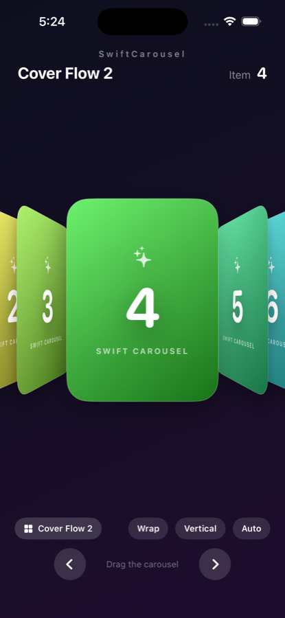
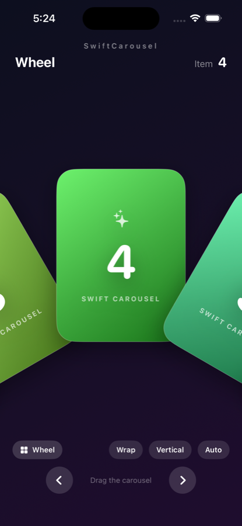
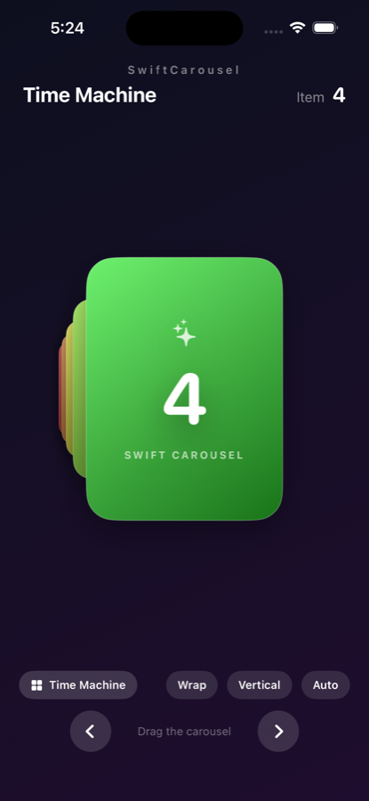

# SwiftCarousel

[](https://github.com/dotcn999/SwiftCarousel/actions/workflows/ci.yml)
[](https://swift.org)
[](#要求)
[](LICENSE.md)

[iCarousel](https://github.com/nicklockwood/iCarousel) 1.8.3 的现代 Swift 重写版：UIKit 负责 3D 布局与滚动物理，SwiftUI 封装负责声明式接入。保留原有 12 种布局、视图复用、占位视图、循环滚动、拖拽惯性、自动滚动和增删刷新能力。

- 纯 Swift 6，无 Objective-C、无 CocoaPods
- 通过 Swift Package Manager 分发
- 最低支持 iOS 16
- 核心逻辑与 1.8.3 逐行对齐，可在真机/模拟器直接对比

| Cover Flow 2 | Wheel | Time Machine |
| --- | --- | --- |
|  |  |  |

## 安装

在 `Package.swift` 中添加：

```swift
dependencies: [
    .package(url: "https://github.com/dotcn999/SwiftCarousel.git", from: "1.0.0")
]
```

或在 Xcode 中选择 **File > Add Package Dependencies…**，添加本仓库后导入：

```swift
import SwiftCarousel
```

## SwiftUI 用法

```swift
import SwiftCarousel
import SwiftUI

struct ContentView: View {
    @State private var index = 0

    var body: some View {
        Carousel(
            items: Array(0..<20),
            currentIndex: $index,
            type: .coverFlow2,
            itemSize: CGSize(width: 230, height: 300),
            options: [.wrap: 1]
        ) { item, _ in
            RoundedRectangle(cornerRadius: 24)
                .fill(Color(hue: Double(item) / 20, saturation: 0.7, brightness: 0.9))
                .overlay(Text("\(item)").font(.largeTitle.bold()))
        }
    }
}
```

自定义布局传入 `customTransform`，相当于原库的 `carousel:itemTransformForOffset:baseTransform:`：

```swift
Carousel(..., type: .custom, customTransform: { offset, base in
    CATransform3DTranslate(base, offset * 200, 0, 0)
})
```

## UIKit 用法

```swift
let carousel = CarouselView(frame: view.bounds)
carousel.dataSource = self // weak，请自行强引用数据源
carousel.delegate = self
carousel.type = .cylinder
view.addSubview(carousel)

func numberOfItems(in carousel: CarouselView) -> Int { items.count }

func carousel(_ carousel: CarouselView, viewForItemAt index: Int, reusing view: UIView?) -> UIView {
    let label = view as? UILabel ?? UILabel()
    label.text = "\(index)"
    return label
}
```

`CarouselDataSource` / `CarouselDelegate` 均为 `@MainActor` 协议；除两个必需方法外，其余回调都有默认实现。所有接口在 UIKit 与 SwiftUI 两种用法下一致。

常用属性：`type`、`isWrapEnabled`、`isVertical`、`isPagingEnabled`、`autoscroll`、`bounces`、`perspective`、`scrollSpeed`、`decelerationRate`、`scrollOffset`、`currentItemIndex`。

常用方法：`scrollToItem(at:animated:)`、`scrollBy(offset:duration:)`、`removeItem(at:animated:)`、`insertItem(at:animated:)`、`reloadItem(at:animated:)`、`reloadData()`。

## 布局类型

`linear`、`rotary`、`invertedRotary`、`cylinder`、`invertedCylinder`、`wheel`、`invertedWheel`、`coverFlow`、`coverFlow2`、`timeMachine`、`invertedTimeMachine`、`custom`。

布局细节可通过 `CarouselOption` 调整：`wrap`、`showBackfaces`、`offsetMultiplier`、`visibleItems`、`count`、`arc`、`angle`、`radius`、`tilt`、`spacing`、`fadeMin`、`fadeMax`、`fadeRange`、`fadeMinAlpha`。

## 文档

包内附带 DocC 目录，在 Xcode 中通过 `Product > Build Documentation` 查看，或阅读仓库中的 [文档源码](Sources/SwiftCarousel/SwiftCarousel.docc)：

- [GettingStarted](Sources/SwiftCarousel/SwiftCarousel.docc/GettingStarted.md)：SwiftUI 与 UIKit 接入
- [Layouts](Sources/SwiftCarousel/SwiftCarousel.docc/Layouts.md)：12 种布局与自定义 transform
- [Options](Sources/SwiftCarousel/SwiftCarousel.docc/Options.md)：可调参数一览
- [MigrationFromICarousel](Sources/SwiftCarousel/SwiftCarousel.docc/MigrationFromICarousel.md)：从 iCarousel 迁移

## 要求

- Xcode 16 或更高版本（Swift 6 工具链）
- iOS 16.0 或更高版本
- 仅支持 iOS；暂不支持 macOS / Mac Catalyst

## 演示 App

仓库已包含生成好的工程，直接打开即可：

```bash
cd Demo
open SwiftCarouselDemo.xcodeproj
```

修改了 `project.yml` 后可用 [XcodeGen](https://github.com/yonaskolb/XcodeGen) 重新生成：

```bash
cd Demo && xcodegen generate
```

演示 App 支持启动参数，便于自动化测试：

```bash
-demoType 8 -demoIndex 4   # 直接打开 Cover Flow 2，并把第 4 项居中
-demoWrap 1 -demoVertical 1 -demoAutoscroll 1
```

运行测试：

```bash
# 包内单元测试
xcodebuild test -scheme SwiftCarousel \
  -destination 'platform=iOS Simulator,name=iPhone 16'

# 演示 App 单元 + UI 测试
cd Demo
xcodebuild test -project SwiftCarouselDemo.xcodeproj -scheme SwiftCarouselDemo \
  -destination 'platform=iOS Simulator,name=iPhone 16'
```

## 与 iCarousel 的差异

- Objective-C 的 `iCarouselType` / `iCarouselOption` 改为 Swift 枚举 `CarouselType` / `CarouselOption`，原始数值保持一致。
- 类名 `iCarousel` 改为 `CarouselView`；SwiftUI 封装名为 `Carousel`。
- 回调改为 Swift 命名风格，例如 `carousel(_:didSelectItemAt:)`、`carouselCurrentItemIndexDidChange(_:)`。
- 严格并发：数据源、代理及视图操作都在主线程执行。
- 不再包含原库的 `iCarousel.h` 单文件（非 ARC / 无模块）支持，只提供 SwiftPM 包。

## 贡献

欢迎提交 Issue 和 Pull Request，详细流程与代码风格见 [CONTRIBUTING.md](CONTRIBUTING.md)。修改后请确保以下命令通过：

```bash
xcodebuild test -scheme SwiftCarousel \
  -destination 'platform=iOS Simulator,name=iPhone 16'
```

如果项目对你有帮助，欢迎 Star。发现布局或滚动手感与原版 iCarousel 有差异时，请在 Issue 中附上布局类型、参数和复现步骤。

## 致谢

- 原始项目：[iCarousel](https://github.com/nicklockwood/iCarousel) by Nick Lockwood（已归档）
- 本项目是基于 1.8.3 源码的独立 Swift 重写，并非官方版本

## 许可

沿用原项目的 zlib 许可证，详见 [LICENSE.md](LICENSE.md)。原始实现版权归 Nick Lockwood 所有。
